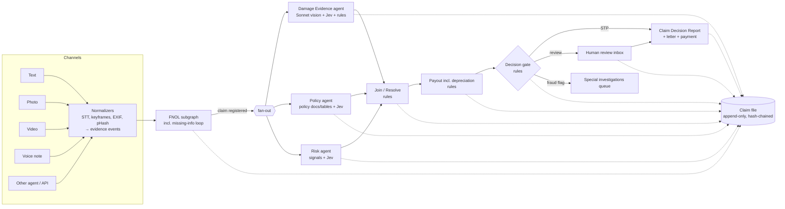
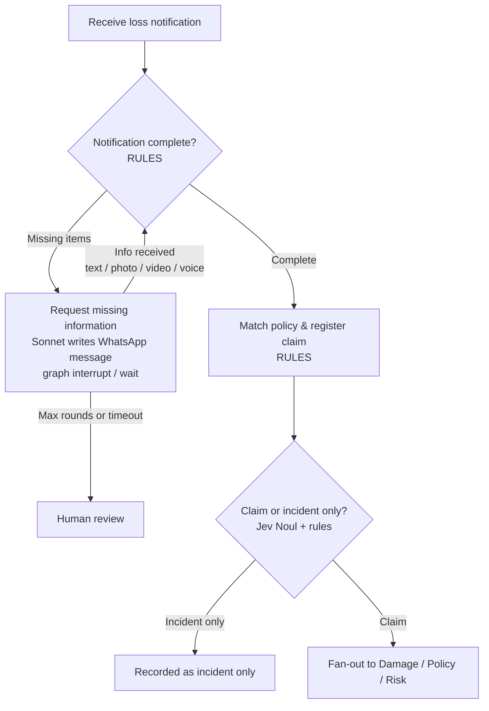

# Property Claims STP — Explainable Multi-Agent Claims Engine (Demo)

> **Status (2026-10-20):** build started. **M0 done** (models, append-only hash-chained event store, blob store, views, Claude + Jev wrappers with raw I/O capture and record/replay). **M1 done** (synthetic data + typed loaders; payout rules reproduce every golden payout). **M2 done (text + image)**: intake normalizers, FNOL extraction with verified source quotes, Jev peril + claim-vs-incident, completeness rules, missing-info loop (interrupt/resume), policy match & registration. Live on S01–S20: peril 20/20, FNOL outcome 20/20 (after correcting 3 golden labels). **M3 done**: parallel Damage / Policy / Risk agents with fan-out and join. Live S01–S20: image–claim consistency 15/19, risk band 17/19 (2 misses need the M4 cross-agent signal). **M4 done**: coverage resolution, payout, final risk, routing gate, human review (approve / override / request info / escalate), settlement with Sonnet letter, ClaimDecisionReport. Live end-to-end on S01–S20: **route 20/20, payout 7/7 to the cent**, coverage 16/19. **M6 done**: split-screen web UI. On the left, a WhatsApp-style chat with persona picker and sample gallery. On the right, the backstage: live process map, event stream, report with "Why?", review inbox, and audit (verify / tamper / replay / export). It also has pace control (normal, slow-motion, pause at the decision gate) and a "Reset demo" button. 193 tests green. Next: M7 PDF export and polish; M2b voice and video still needs ffmpeg.

### How to run the demo

```bash
cd web && npm install && npm run build && cd ..
.venv\Scripts\python.exe -m uvicorn app.api.main:app --port 8000
```

Open http://localhost:8000. Click **Reset demo** before each session; earlier claims are archived to `var/archive/`, and nothing is deleted. Presenter hotkeys: **B** shows or hides the backstage, **1–4** switch tabs, **G** continues past the paused decision gate.
> This README is the full spec/hand-off. A new session should be able to start building from this file alone.
> **Guiding rule for v1:** this is a **sales demo**. *Simple, explainable and working* beats spec exactness. Domain refinements come later.

---

## 1. Goal

An intelligent, scalable and **explainable** AI service that turns **coverage assessment and repair-cost validation** for property claims (water, storm, fire, and more) into a **straight-through process (STP)** — from first notification of loss (FNOL) to payment recommendation.

For every claim the system:

1. takes the notification (text, photo, video, voice note, or another agent/system),
2. asks for missing information until the notification is complete,
3. extracts the visible damage from images (vision model) and checks it against the customer's story and the repair estimate,
4. compares the estimate with supplier price benchmarks and applies depreciation,
5. verifies the policy (coverage, deductible, limits, exclusions) — **only from policy documents, policy tables or explicit rule config**,
6. scores risk/anomalies,
7. recommends **payout** or **human review**,
8. and writes **every decision to the audit trail** — every question, answer, probability, rule, model call and human action.

**Scope v1:** a demo with synthetic data, WhatsApp-style chat UI, bilingual (Dutch + English), presentable in **15 minutes** (see §15).

---

## 2. Architecture principles (non-negotiable)

The core problem: one big agent drowns in context; a long chain of agents ends up working on "a summary of a summary of a summary". So:

| # | Principle | Consequence |
|---|---|---|
| 1 | **One shared claim file.** Every event is appended; nothing is ever overwritten. | Append-only event log = system of record + audit trail. |
| 2 | **The graph runs the claim.** LangGraph is the process engine and decides which step comes next. | Agents don't call each other; the graph orchestrates. |
| 3 | **Rules for rule-based steps.** Completeness, calculations, depreciation, limits, deductibles, authority checks, payment controls are plain, tested code. | No LLM ever does arithmetic or authority decisions. |
| 4 | **Agents only where judgement is needed.** Evidence review, coverage interpretation, fraud signals, conversation, letters. | Small, focused agents. |
| 5 | **A human can step in at any node.** Agent proposes; human approves when confidence is low, amount is high, or the outcome is adverse. | `interrupt()` points + human decisions are events in the claim file. |
| 6 | **Typed everything.** All inputs, outputs and shared state are **Pydantic v2 models**. | No dicts-of-anything crossing boundaries; schemas are versioned. |
| 7 | **No unstructured free text between agents.** Agents write structured findings with evidence references. Each agent reads a *purpose-built view* of the claim file; views are built by code and **strip all prose fields** (`reasoning`, `summary`). | Prose exists for humans and audit only. Enforced by a test. |
| 8 | **Uniform agent output.** Every agent output includes `confidence`, `evidence`, `reasoning`, `summary`, `warnings` (§5.1). | One envelope, one renderer, one audit format. |
| 9 | **Confidence is labelled by source.** `rule` (1.0), `measured` (Jev probabilities), `self_reported` (Sonnet). **Routing only uses `rule` and `measured`.** | "We don't let the AI grade its own homework." |
| 10 | **No invented policy rules.** Every coverage/limit/deductible/depreciation decision cites a `clause_id` from a policy document, a row in a policy table, or an entry in explicit rule config. No source → `unresolved` → human. | Enforced by validation + tests. |
| 11 | **Every decision is audited.** Rules, model calls (raw I/O), routing, human actions, outbound messages, errors. | Full, replayable, tamper-evident trail (§6). |
| 12 | **Asymmetric automation.** Approvals may go straight through; coverage denials / partial denials always go to a human. Price trimming to benchmark and depreciation are *valuation*, not denial, and may go STP (with reason codes). | Regulator-friendly (GDPR Art. 22). |

---

## 3. Workers

| Worker | Used for | Never used for |
|---|---|---|
| **Code (rules)** | Completeness matrix, policy lookup, limits, deductibles, **depreciation**, price benchmarking, image-vs-claim field comparison, hard fraud signals (EXIF, image hash, frequency), routing, authority, payment controls | Judgement |
| **Jev** (TypeSafe, non-generative decision model) | Typed judgement atoms with **measured probabilities**: severity, "does the photo support the story", sudden vs gradual, "does exclusion X apply", narrative consistency, claim vs incident | Free text, extraction |
| **Claude Sonnet 5.5** (`claude-sonnet-5-5`) — text | FNOL field extraction, WhatsApp conversation, missing-info questions, selecting policy clauses (ids only), mapping estimate lines to repair codes, letters, reviewer summaries — bilingual NL/EN | Final decisions, calculations, routing |
| **Claude Sonnet 5.5** — **vision** | **Damage evidence extraction** from photos and video keyframes: room, materials, damage types, visible items, mould/rust/tide marks, image quality — typed, per image | Judging consistency or coverage (that's Jev + rules) |
| **Speech-to-text** (`faster-whisper`, local) | Voice notes and video audio tracks → timestamped transcripts (NL/EN) | — |

**Explainability by decomposition:** every agent is a battery of small, typed steps. The decision trail is a list of `question → answer → probability → evidence used → rule that consumed it`. No reasoning prose needs to be trusted.

---

## 4. High-level flow



Every node **reads a typed view** from and **appends events** to the claim file.

---

## 5. Data contracts (Pydantic v2)

Spec-level shapes; exact fields are finalised during M0.

### 5.1 Common agent output envelope

```text
EvidenceRef
  evidence_id: str                  # EV-0003
  kind: text | image | keyframe | transcript | document | policy_clause | price_row | rule_config
  locator: str | None               # quote span, image region, timestamp, clause_id, table row

Warning
  code: str                         # e.g. IMG_LOW_QUALITY, EXIF_MISSING, CLAUSE_ID_UNKNOWN
  severity: info | warning | critical
  message: str                      # human-readable, NL/EN

Confidence
  value: float                      # 0..1
  source: rule | measured | self_reported
  basis: str                        # e.g. "jev noul photo_supports_story", "rule PAY-CAP-01"

AgentOutput[T]
  agent: str                        # damage_agent, policy_agent, ...
  agent_version: str
  claim_id: str
  finding: T                        # typed, agent-specific (below)
  confidence: Confidence
  evidence: list[EvidenceRef]       # min 1
  reasoning: str                    # for humans/audit ONLY — stripped from agent views
  summary: str                      # for humans/audit ONLY — stripped from agent views
  warnings: list[Warning]
```

Agent-specific findings (`T`): `FnolExtraction`, `ImageDamageAssessment`, `ImageClaimConsistency`, `PolicyFinding`, `RiskAssessment`, `CoverageResolution`, `PayoutCalculation`, `RoutingDecision`.

### 5.2 Shared graph state

Kept deliberately thin — the **event store is the source of truth**, the graph state is only execution context:

```text
ClaimGraphState
  claim_id: str
  stage: fnol | assessment | join | payout | routing | review | closed | incident_only
  info_request_rounds: int
  last_event_seq: int
  pending_interrupt: InterruptReason | None
```

Agents never read the graph state for facts; they read **views** (§6.4).

### 5.3 System output — `ClaimDecisionReport`

The single product of the pipeline, built by code from events (so it is always reconstructable):

| Section | Content |
|---|---|
| **Claim summary** | Claim id, customer, policy, peril, loss date, location, channel(s), language; short bilingual summary (Sonnet, from structured data only) |
| **Image damage assessment** | Per image/keyframe: room, materials, damage types, severity (Jev choice + probabilities), visible items, quality warnings |
| **Image–claim consistency result** | `consistent \| partially_consistent \| inconsistent \| cannot_assess` + per-check list (rule comparisons + Jev `photo_supports_story`, per-item visibility) |
| **Coverage decision** | `covered \| partially_covered \| not_covered \| unresolved` + per clause: status, condition, fact used, clause id / source |
| **Risk score** | 0–1, per-signal contributions, hard flags |
| **Payout recommendation** | Per line: claimed → benchmark-validated → depreciation → covered amount; then limits, deductible, final payout; every step with rule id |
| **Human approval status** | `not_required (STP) \| pending \| approved \| overridden \| info_requested \| escalated_siu` + reviewer id, role, reason, timestamp |
| **Audit trail** | Ordered event list (or link/export), chain-integrity status, config versions used |

Rendered in the UI, exportable as JSON + PDF.

---

## 6. Claim file & audit trail

### 6.1 Stores

| Store | Purpose | Demo tech | Later |
|---|---|---|---|
| **Claim file / event store** | Business record & audit trail | SQLite table behind an `EventStore` interface | Postgres |
| **LangGraph checkpointer** | Execution state only (pause/resume, e.g. waiting for missing info) | `SqliteSaver` | `PostgresSaver` |
| **Blob store** | Photos, video, audio, PDFs, **raw model requests/responses** — by content hash | `./data/blobs/<sha256>` | S3/Azure Blob |

### 6.2 Event envelope

```json
{
  "claim_id": "CLM-2026-000123",
  "seq": 17,
  "event_id": "uuid",
  "type": "finding.created",
  "actor": {"kind": "agent|rule|human|system|customer", "id": "damage_agent", "role": null},
  "timestamp": "2026-10-18T10:21:00Z",
  "payload": { },
  "evidence_refs": ["EV-0003", "EV-0004"],
  "provenance": {
    "model": "jev-1.13.0 | claude-sonnet-5-5 | faster-whisper-<size> | null",
    "prompt_or_question_set_version": "damage_water_v1",
    "rule_id": "PAY-DEDUCT-01 | null",
    "rule_source": "policy:HOME-B-2026#clause-4.2 | table:depreciation#electronics | config:routing.yaml | null",
    "config_versions": {"thresholds": "sha256…", "risk_weights": "sha256…", "authority": "sha256…"},
    "raw_request_blob": "sha256 | null",
    "raw_response_blob": "sha256 | null"
  },
  "prev_hash": "sha256 of previous event (same claim)",
  "hash": "sha256 of this event"
}
```

- **One hash chain per claim.** Current claim status is **derived** (projection) from events; never stored as mutable truth.
- Every model call (Sonnet text/vision, Jev, STT) stores its **exact raw request and response** in the blob store, referenced from the event.

### 6.3 Event types

- `claim.notified`, `claim.registered`, `claim.recorded_as_incident`
- `evidence.received` (text / image / video / audio / document / agent_payload)
- `evidence.normalized` (transcript, keyframes, EXIF, perceptual hash, resized image)
- `fnol.field_extracted`, `fnol.completeness_evaluated`
- `fnol.info_requested` / `fnol.info_received`
- `message.sent` (every outbound WhatsApp message / letter, full text + language)
- `policy.matched`
- `vision.extracted` (per image, typed)
- `jev.answered` (question id, full question, answer, probabilities/noul, confidence, evidence refs)
- `finding.created` (full `AgentOutput`)
- `rule.evaluated` (rule id, rule source, inputs, output)
- `coverage.resolved`, `risk.scored`, `depreciation.calculated`, `payout.calculated`
- `routing.decided` (STP / human / SIU, reason codes)
- `human.review_requested`, `human.decision` (approve / override / request info; reviewer id + role + mandatory reason on override)
- `report.generated`, `letter.generated`, `payment.instructed`, `claim.closed`
- `system.error` (API failures, timeouts, retries, fallbacks — no silent gaps)

### 6.4 Views (context slices)

Built by code from events; **prose fields (`reasoning`, `summary`) are always stripped**.

- **Damage view:** customer story (original text/transcript), extracted FNOL fields, all images/keyframes, estimate line items, peril.
- **Policy view:** policy record + clause texts + policy tables, FNOL fields (date, cause, peril, location), fact-key definitions.
- **Risk view:** FNOL fields, EXIF/hash outputs, policy start date, past claims, historic image hashes, estimate + benchmark.
- **Payout view:** structured findings only (validated lines, coverage resolution, depreciation table rows, deductible, limits).
- **Reviewer view:** everything (incl. prose), rendered as a timeline.

### 6.5 Audit features shown in the demo

1. **Verify integrity** — recomputes the hash chain; green tick, or the exact event where it breaks (tamper the DB live to show it).
2. **"Why?"** on any number or route — walks back through rules and Jev answers to the evidence photo/quote/clause.
3. **Replay** — recomputes coverage, payout and route from events alone and proves they match what was logged.
4. **Export audit file** — one JSON + PDF bundle per claim.

*Later (not v1):* read-access logging; GDPR erasure via per-claim encryption keys (crypto-shredding).

---

## 7. Intake & FNOL subgraph



### 7.1 Intake normalizers (code, per channel → `evidence.received` + `evidence.normalized`)

| Channel | Normalization |
|---|---|
| Text | Stored as-is; language detected (nl/en) |
| Image | Convert to JPEG/PNG, resize longest side ≤ 1568 px, extract **EXIF** (timestamp, GPS, device), compute **perceptual hash** |
| Video | Keyframes (1 fps + scene changes, max ~8) → treated as images (EXIF from container metadata, pHash per frame); audio track → transcript |
| Voice note | `faster-whisper` speech-to-text with timestamps (NL/EN); original audio kept |
| Other agent / API | Typed endpoint accepting the same evidence schema (MCP/A2A-compatible later) |

### 7.2 Steps

1. **Extract fields** (Sonnet, structured output → `FnolExtraction`): loss date/time, peril/cause, location/room, affected items **(+ approximate age per item)**, source stopped, emergency measures, estimate attached, third party, police/fire report. **Each field carries an exact source quote** (`EvidenceRef` with locator); a field without a quote is treated as missing.
2. **Classify peril** (Jev Choice): `water_burst_or_leak`, `storm_wind_hail`, `fire_smoke`, `theft_burglary`, `accidental_damage`, `other_unclear`.
3. **Completeness** (rules): per-peril **required-fields matrix** (`config/completeness.yaml`). E.g. water → loss date, source, source stopped, room, photos; storm → loss date, address, exterior photos; fire → loss date, fire brigade report ref, photos. **Item age is required for depreciable items.**
4. **Missing-info loop**: Sonnet writes one friendly bilingual WhatsApp question covering only the missing items; graph `interrupt()`s; resumes on the next `evidence.received` for that claim (any channel — customer may answer by text, photo, video or voice). Max rounds and timeout in config (default: 2 rounds) → then human review.
5. **Match policy & register** (rules): customer id/phone + address + policy active on loss date.
6. **Claim vs incident only** (Jev Noul + rule): "Is the customer asking for compensation / a repair?" → incident-only if explicitly stated or Noul < threshold.

### 7.3 Conversational channel

The WhatsApp-style chat is driven by Sonnet as a front-end. It **never decides** anything — it collects evidence and relays requests produced by the graph. Replies in the customer's language (auto-detected, switchable). Every outbound message is a `message.sent` event.

---

## 8. Parallel assessment agents

Damage, Policy and Risk run **in parallel** (LangGraph fan-out, join waits for all three). No agent waits on another.

### The key trick: fact keys + conditional coverage

- The **Damage agent** always answers a fixed **fact battery per peril** (fact keys like `sudden_vs_gradual`, `long_term_moisture_signs`, `damage_consistent_with_cause`).
- The **Policy agent** expresses clauses as **conditions over those fact keys** ("excluded if `sudden_vs_gradual == gradual_long_term`"), each citing a clause id.
- **Join** (code) evaluates conditions against facts → `coverage.resolved`. A fact with an `unclear_*` answer → condition `unresolved`.

### 8.1 Damage Evidence agent

Inputs: damage view. Four steps:

**Step 1 — Vision extraction (Sonnet 5.5 vision, one call per image/keyframe → `vision.extracted`):**

```text
ImageObservation
  evidence_id
  image_quality: good | blurry | too_dark | partial_view | not_a_damage_photo
  room_type: kitchen | bathroom | living_room | bedroom | attic | exterior_roof | exterior_facade | other | unknown
  materials: [laminate, tiles, drywall, cabinet, roof_tile, ...]
  damage_types: [water_staining, swelling, mould, rust, tide_marks, burn, soot, broken, missing_tiles, ...]
  visible_items: [ {label, damaged: bool, region?} ]
  long_term_signs_visible: bool
  confidence (self_reported)
```

**Step 2 — Jev battery (one batched call per claim, measured probabilities):** severity (choice), `photo_supports_story` (noul), `sudden_vs_gradual` (choice), `long_term_moisture_signs` (noul), `item_<n>_visible` per estimate line (noul).

```json
{
  "model": "jev-latest",
  "state": {
    "story": "Last night a pipe under the kitchen sink burst...",
    "photo_1": "<asset-ref-uuid-1>",
    "photo_2": "<asset-ref-uuid-2>",
    "estimate_items": ["Replace kitchen base cabinet", "Replace laminate floor 12 m2", "Repaint living room"]
  },
  "questions": {
    "severity": {
      "type": "choice",
      "instructions": "How severe is the visible water damage in `photo_1` and `photo_2`?",
      "criteria": {
        "none_no_visible_damage": "No visible damage",
        "minor_surface_staining": "Light staining or surface wetness only",
        "moderate_localized_damage": "Localized swelling, staining or damaged materials in one area",
        "severe_extensive_damage": "Extensive damage across multiple surfaces or materials",
        "other_cannot_assess": "Photos do not allow an assessment"
      }
    },
    "photo_supports_story": {"type": "noul", "instructions": "Do `photo_1` and `photo_2` support `story`?"},
    "sudden_vs_gradual": {
      "type": "choice",
      "instructions": "Does the damage in the photos look sudden or gradual?",
      "criteria": {
        "sudden_recent_event": "Fresh water damage consistent with a single recent event",
        "gradual_long_term": "Signs of long-term exposure: mould, rot, rust, layered tide marks",
        "unclear_cannot_tell": "Cannot tell from the photos"
      }
    },
    "long_term_moisture_signs": {"type": "noul", "instructions": "Are there signs of mould, rot or long-term moisture in the photos?"},
    "item_1_visible": {"type": "noul", "instructions": "Is the kitchen base cabinet visibly damaged in the photos?"}
  }
}
```

**Step 3 — Image–claim consistency (rules over Steps 1–2 → `ImageClaimConsistency`):**

| Check | Source |
|---|---|
| Room in images matches claimed room | Rule: vision `room_type` vs FNOL location |
| Damage types match claimed peril | Rule: vision `damage_types` vs peril → expected-damage map (config) |
| Photo supports story | Jev noul (measured) |
| Each estimate item visible | Jev noul per item (measured) |
| Long-term signs vs "sudden" story | Rule: vision + Jev `long_term_moisture_signs` |
| Image quality sufficient | Rule: vision `image_quality` |

Result: `consistent | partially_consistent | inconsistent | cannot_assess` + per-check results. Two independent signals (vision-extracted facts via rules, and Jev's measured judgement) make mismatches explainable. `cannot_assess` (e.g. blurry) → missing-info request for better photos.

**Step 4 — Pricing (rules):** estimate lines → standard repair codes (Sonnet, ids only, validated against the price table) → priced against `PriceReference` → per line `within_range | above_range(+x%) | not_visible_in_evidence`. Validated amount = `min(claimed, benchmark_p75 × (1 + tolerance))`; zero if not visible and not otherwise justified.

**Jev note:** decision heads follow **option names** more than descriptions → self-explanatory names (`sudden_recent_event`, not `A`); always include an `other_…`/`unclear_…` option.

### 8.2 Policy agent

**Sources of truth (and nothing else):**

| Source | Contains |
|---|---|
| **Policy document** (synthetic, NL + EN, clause ids) | Cover, exclusions, conditions |
| **Policy tables** | Sum insured, sublimits per peril, deductibles, **depreciation schedule**, new-value period, `excluded_source_repair` codes |
| **Explicit rule config** | Clause → fact-key conditions, each entry referencing its `clause_id` |

Steps:
- **Rules:** policy active on loss date, insured address matches, peril in cover list, sum insured, sublimit, deductible.
- **Sonnet:** select relevant clauses for this peril/cause → **clause ids only**; ids not in the policy are rejected (`CLAUSE_ID_UNKNOWN` warning).
- **Jev:** Noul questions for exclusions/conditions depending only on FNOL facts (e.g. "Was the home unoccupied for more than 60 days?").
- **Output** (`PolicyFinding`): per clause `covered | excluded | conditional(fact_key == value)`, with clause id. No clause found for a question → `unresolved`.

### 8.3 Risk agent

Transparent weighted sum, weights in `config/risk_weights.yaml`:

| Signal | Source |
|---|---|
| EXIF timestamp before loss date / missing EXIF | Code |
| GPS far from insured address | Code |
| Perceptual-hash match with a past-claim photo (any customer) | Code → **hard flag** |
| Policy started < 60 days before loss | Code |
| Claim frequency (customer, last 3 years) | Code |
| Estimate above benchmark by > X% | Code (Risk reads the price table itself — stays parallel) |
| Story internally consistent? | Jev Noul |
| Timeline plausible? | Jev Noul |
| Photo supports story | Jev Noul (shared question result) |

Output `RiskAssessment`: score 0–1, per-signal contributions, hard flags (force SIU).

---

## 9. Join, depreciation, payout, routing (all code)

### 9.1 Join / Resolve
Evaluate policy conditions against damage fact keys → `coverage.resolved`: `covered | partially_covered | not_covered | unresolved`. Coverage is resolved **per claim**; the only per-line exception in v1 is `excluded_source_repair` (e.g. "the burst pipe itself is not covered, only the resulting damage"), driven by the policy table.

### 9.2 Depreciation (from the policy's depreciation table — never invented)

Per item category (policy table rows, each with a clause id):

```text
category, depreciable (bool), annual_rate, max_depreciation, new_value_years, clause_id
e.g. electronics:  true, 15%/yr, 70%, 1 yr
     flooring:     true, 5%/yr,  50%, 2 yrs
     labour:       false
```

```text
if not depreciable or age <= new_value_years: depreciation = 0
else: depreciation = validated × min(max_depreciation, annual_rate × (age − new_value_years))
```

Item age comes from FNOL extraction (asked in the missing-info loop if missing). Still unknown → warning `ITEM_AGE_UNKNOWN` → human review.

### 9.3 Payout

```text
for each line item:
    validated   = min(claimed, benchmark_p75 × (1 + tolerance))   # 0 if not supported by evidence
    if excluded_source_repair(line): covered_amount = 0            # clause-cited
    else: covered_amount = validated − depreciation(line)
eligible = min(Σ covered_amount, peril_sublimit, sum_insured)      # cap first
payout   = max(0, eligible − deductible)                           # then deductible
```

Every step emits `rule.evaluated` (rule id + source + inputs + output) → the number is fully reconstructable and replayable.

### 9.4 Routing (decision gate)

Uses only `rule` and `measured` confidences.

| Route | Conditions |
|---|---|
| **STP (auto-approve)** | coverage `covered`; consistency `consistent`; no critical Noul in uncertain band (0.25–0.75); critical Choice confidences ≥ 0.6; risk < 0.3; no hard flag; no critical warning; payout ≤ €5,000 |
| **Human review** | coverage denial/partial, `unresolved`, consistency `partially_consistent`/`inconsistent`, uncertain answers, risk 0.3–0.7, critical warnings, payout above STP limit, missing-info loop exhausted |
| **SIU / fraud** | any hard flag or risk ≥ 0.7 |

Benchmark trimming and depreciation are valuation, not denial → allowed in STP, explained with reason codes.

**Authority matrix (config):** ≤ €5k auto; €5k–€25k claims handler; > €25k senior handler.

All thresholds in config (versioned, hash recorded per decision), tuned against the synthetic eval set. Noul has no confidence field — use `|2p − 1|` where a comparable scale is needed.

### 9.5 Human in the loop
- Any node can be an interrupt point (`interrupt_before`) for demo/debugging.
- Reviewer sees the reviewer view + proposed `ClaimDecisionReport`; actions: **approve**, **override** (reason mandatory), **request info** (back into the FNOL loop), **escalate to SIU**.
- Every action is a `human.decision` event with reviewer id, role, reason, timestamp → updates *human approval status* in the report.

### 9.6 Output
- `ClaimDecisionReport` (§5.3) generated by code from events.
- Sonnet writes the customer letter / WhatsApp message (NL or EN) and the reviewer summary **from the decision record only**, citing reason codes.
- `payment.instructed` (demo: mock).

---

## 10. Jev (TypeSafe) reference notes

Docs: https://docs.typesafe.ai/introduction · index: https://docs.typesafe.ai/llms.txt

- **What:** "System One" non-generative decision model. Send a `state` + typed `questions`; get typed answers. Questions are evaluated **independently and in parallel** — batch them in one call.
- **Endpoint:** `POST https://api.typesafe.ai/v1/systemone`, header `Authorization: Bearer $TYPESAFE_API_KEY`.
- **SDK:** Python `typesafe-sdk` (≥ 3.10): `from typesafe_sdk import Choice, Noul, Score, Image, TypeSafeClient`; `client.system_one(model="jev-latest", state=..., questions=...)`; read `response.answers["<id>"]`.
- **Question types:** `choice` (criteria map, returns `choice`, `probabilities`, `confidence`); `noul` (returns P(yes), no confidence field); `score` (ordered levels, returns `score`, `probabilities`, `legend`, `confidence`); `box` (preview, could later highlight damage regions).
- **Images:** PNG/JPEG only; 280–1568 px per side; ≤ 16 MiB each, ≤ 32 MiB total. Header `TypeSafe-Danger-Zone-Images: true`. Put each image in `state` once and reference by path. **No video/audio** → keyframes + transcripts.
- **Response** includes resolved `model` version → logged in `provenance`.
- Question ids are never seen by the model; option names and descriptions are.
- **Open:** Dutch-language `state` quality untested — evaluate on synthetic NL claims; keep questions/criteria in English.

---

## 11. Synthetic data (`data/synthetic/`)

> **Status (2026-10-20): first version built.** See [data/synthetic/README.md](data/synthetic/README.md): 20 openly licensed images, golden image observations, 8 personas, 4 products / 8 policies with NL+EN clause wording, a price benchmark, 20 claim storylines with recomputed golden payouts, and claim history. The 20 storylines (S01–S20) replace the 12-scenario list below as the eval set.

- **Policies (~5):** home contents + building; policy documents with clause ids (NL + EN); policy tables (sum insured, sublimits, deductibles, **depreciation schedule**, new-value period, `excluded_source_repair` codes); start dates.
- **Customers:** id, name, phone (fake), address, language preference.
- **Past claims history:** incl. stored image hashes and frequencies.
- **Supplier price benchmark:** repair codes × region → p25/p50/p75, `depreciable` flag, item category.
- **Media:** photos (source TBD: openly licensed and/or generated), short videos, NL/EN voice notes (recorded or TTS). Fraud scenarios need deliberately reused/altered images.
- **Test claims (12) with golden outcomes:**

| # | Scenario | Expected route |
|---|---|---|
| 1 | Clean water burst, complete, within benchmark, depreciation applied | STP |
| 2 | Gradual leak (mould/rot visible) | Human (exclusion → adverse) |
| 3 | Storm damage, estimate 60% above benchmark | STP with trimmed lines (valuation) or Human if consistency/risk flags |
| 4 | Fire, brigade report present, high amount | Human (authority) |
| 5 | Photo duplicates a past claim | SIU |
| 6 | Incomplete notification → missing-info loop (answered by **video**) → complete | STP after loop |
| 7 | Incident only (customer just reporting) | Recorded as incident |
| 8 | Photo does not match the story (different room/damage) | Human (inconsistent) |
| 9 | EXIF date before loss date | Human / SIU |
| 10 | Policy started 3 weeks before loss | Human |
| 11 | Ambiguous evidence (blurry photos) → info request → still unclear | Human |
| 12 | Dutch voice-note claim, clean | STP |

**Later:** `PriceReference` backed by web search + similar past reports.

---

## 12. Tests & evaluation

### 12.1 Unit tests (`pytest`, deterministic, **never call live models**)

Model outputs (Sonnet, vision, Jev, STT) are **recorded once as fixtures and replayed**.

| Area | Must cover |
|---|---|
| **Routing** | Every route; every threshold edge (Noul 0.25/0.75, choice 0.6, risk 0.3/0.7, €5k, €25k); `self_reported` confidence never affects routing; hard flag always wins |
| **Risk thresholds** | Each signal in isolation; weighted sum; weights from config; hard flags force SIU regardless of score |
| **Image–claim mismatch** | Room mismatch, peril/damage-type mismatch, low `photo_supports_story`, item not visible, long-term signs vs "sudden" story, blurry → `cannot_assess` |
| **Policy decisions** | Fact key × clause condition → covered/excluded/conditional; `unclear_*` fact → unresolved; no clause → unresolved; unknown clause id rejected; inactive policy; address mismatch; peril not covered |
| **Payout decisions** | Hand-computed examples: benchmark cap, unsupported line = 0, `excluded_source_repair`, depreciation (new-value period, max cap, non-depreciable labour, unknown age), sublimit, sum insured, deductible, never negative |
| **Audit / architecture** | Hash chain detects tampering; replay reproduces payout + route; every rule config entry has a source; agent views contain no `reasoning`/`summary`; every decision type emits an event |

### 12.2 Evaluation harness

`python -m eval.run` runs all 12 scenarios end-to-end **with live models**, compares to golden labels (route, coverage, consistency result, payout ± tolerance, flags, FNOL completeness). Report: accuracy per dimension, route confusion matrix, cost/latency per claim. Used to tune thresholds and as regression suite (reported separately from unit tests — not deterministic).

---

## 13. Demo UI

Single web app, run **locally on the presenter's laptop**, shown on one screen/projector as a **split screen**:

```
┌──────────────────────────┬──────────────────────────────────────────────┐
│  FRONT STAGE             │  BACKSTAGE                                   │
│  what the customer sees  │  what the system is doing                    │
│                          │  tabs: [Live] [Report] [Review inbox] [Audit]│
│  ┌────────────────────┐  │                                              │
│  │ phone frame        │  │  Live:                                       │
│  │ WhatsApp-style     │  │   1. Process map — graph nodes light up      │
│  │ chat               │  │      (FNOL → Damage‖Policy‖Risk → Join →     │
│  │                    │  │       Payout → Gate), waits/interrupts shown │
│  │ [📎][📷][🎤] ____ ➤ │  │   2. Event stream — readable cards, newest   │
│  └────────────────────┘  │      on top, expandable to raw JSON          │
│  persona · NL/EN · reset │                                              │
└──────────────────────────┴──────────────────────────────────────────────┘
```

**Front stage — customer chat (left, ~35%):** the prospect plays the customer (§15). Phone-frame WhatsApp look; text, photo/video/document upload, laptop camera capture, voice-note recording (browser MediaRecorder), sample media gallery, typing/progress indicators, NL/EN auto-detect (switchable), persona picker, "start over". Shows **only** what a real customer would see.

**Backstage (right, ~65%), four tabs:**

1. **Live** (default)
   - **Process map:** the LangGraph flow as a diagram; the active node pulses, finished nodes turn green/amber/red, the parallel fan-out is visibly parallel, an interrupt (waiting for customer) is shown as a pause icon.
   - **Event stream:** one card per event, in plain language first, detail on click:
     - *Voice note transcribed* → transcript with highlighted extracted fields
     - *Vision extraction* → photo thumbnail + extracted tags (room, damage types, items)
     - *Jev answers* → question + probability bar + measured-confidence badge
     - *Rule evaluated* → rule id, inputs → output, source clause/table row
     - *Agent output* → summary, confidence badge (rule / measured / self-reported), warnings
     - *Routing* → route + reason codes
     - every card expands to the raw event JSON (hash, prev_hash, provenance)
2. **Report:** the `ClaimDecisionReport` filling up section by section as the claim progresses (claim summary, image assessment, consistency, coverage, risk, payout, approval status, audit trail). **"Why?"** on any number/route.
3. **Review inbox:** claims awaiting a human; the presenter acts as reviewer (approve / override with reason / request info / escalate). The decision appears immediately in the chat on the left.
4. **Audit:** Verify integrity, Tamper (demo button that edits one row in SQLite), Replay, Export audit file.

**Presentation requirements (projector-friendly):**
- Large fonts, high contrast, light theme; readable from the back of a meeting room.
- **Pace control:** `normal` / `slow-motion` (adds a short delay per backstage card so the audience can follow) / `pause at gates` (stops before routing so the presenter can explain).
- Plain-language labels by default (NL/EN), technical detail one click away.
- Hotkeys for the presenter: toggle backstage, switch tabs, reset demo.

---

## 14. Tech stack

| Concern | Choice |
|---|---|
| Language | Python 3.11+ |
| Orchestration | **LangGraph** (fan-out/join, `interrupt()`, checkpointer) |
| Schemas | **Pydantic v2** for all inputs, outputs, state, config |
| Decision model | **Jev** via `typesafe-sdk` |
| LLM + vision | **Claude Sonnet 5.5** (`claude-sonnet-5-5`) via `anthropic` SDK, structured outputs |
| Speech-to-text | `faster-whisper` (local) |
| Media | Pillow (EXIF, resize), `imagehash` (pHash), ffmpeg/OpenCV (keyframes, audio extraction) |
| Storage | SQLite (event store + `SqliteSaver`), local blob folder — behind interfaces |
| API | FastAPI (+ WebSocket/SSE for live timeline & chat) |
| Frontend | React + Vite + Tailwind — *confirm* |
| Tests | pytest + recorded model fixtures |
| Config | YAML (validated by Pydantic): completeness, thresholds, authority, risk weights, consistency map, question sets, clause conditions |
| Secrets | `.env`: `ANTHROPIC_API_KEY`, `TYPESAFE_API_KEY` |

### Proposed structure

```
claims-stp/
  app/
    models/            Pydantic: envelope, findings, state, report, events, config
    api/               FastAPI routes (chat, claims, review, events stream, export)
    graph/             LangGraph: main graph, fnol subgraph, join, routing
    agents/            fnol_extract.py, damage.py (vision + jev), policy.py, risk.py, letters.py
    jev/               client wrapper + versioned question sets
    vision/            Sonnet vision extraction
    rules/             completeness, consistency, coverage, depreciation, payout, routing, risk_signals
    intake/            normalizers: text, image, video, audio (STT), agent_api
    store/             event_store (interface + sqlite, hash chain), blobs, views, replay
    pricing/           price_reference (interface + synthetic impl)
    report/            ClaimDecisionReport builder, PDF/JSON export
    i18n/              nl/en templates
  config/              completeness, thresholds, authority, risk_weights, consistency, clause_conditions (.yaml)
  data/synthetic/      policies (docs + tables), customers, history, prices, claims, media
  eval/                run.py, golden labels, report
  web/                 React app
  tests/               unit tests + recorded fixtures
```

---

## 15. Demo experience — free play (15 minutes)

The demo is **not a script**. It runs on the **presenter's laptop** in a split screen (§13): on the left the prospect **plays the customer** in the WhatsApp-style chat and decides how to report the loss — text, voice note, photo, video, document, in any order, NL or EN, mixed; on the right the audience sees **what happens behind the scenes**, live. The system must handle whatever the prospect does. The presenter only steers.

### 15.1 How a session works

1. **Pick a persona** (customer + address + policy). Needed so the policy match works without real data. Each persona has a distinct policy (e.g. one with a recent start date, one with high deductible).
2. **Chat freely.** The attach menu offers the laptop camera/mic/files **and a sample media gallery**: labelled damage photos, short videos and voice notes, including "trick" items (photo reused from a past claim, mould/long-term damage, wrong room, old EXIF date). Prospects rarely have damage photos on hand — the gallery lets them provoke any outcome themselves.
3. **Watch it think.** While the prospect chats, the backstage shows the process map lighting up and the event stream filling (transcripts, vision tags, Jev probabilities, rules, routing). Presenter can hide the backstage for a "pure customer" moment, then reveal it.
4. **See the outcome.** STP → payout message + letter in chat, report complete in the Report tab. Review → claim appears in the Review inbox tab; the presenter acts as reviewer and the decision lands in the chat. Missing info → the bot asks, and the prospect answers however they like.
5. **Audit close.** Verify integrity, tamper → red, Replay, "Why?", Export.

Rough shape: ~2 min intro · ~10 min free play · ~3 min review inbox + audit.

### 15.2 Robustness requirements (because input is unscripted)

| Situation | Required behaviour |
|---|---|
| Inputs arrive in any order / across many messages | Every input is just `evidence.received`; completeness is re-evaluated after each one |
| Undamaged photo (e.g. prospect photographs the meeting room) | Vision → `not_a_damage_photo` / Jev severity `none` → polite request for a damage photo; never a crash or a fake assessment |
| Off-topic or test messages ("hello?", jokes) | Sonnet answers briefly and steers back; no claim events beyond `evidence.received` |
| Mixed / switched language | Reply in the language of the latest customer message |
| Customer changes their story mid-chat | New extraction events; the latest sourced value wins, the change is visible in the trail (and is a risk signal) |
| Slow steps (STT, video, Jev, vision) | Visible progress per step in chat ("transcribing your voice note…") and in the timeline; target < 20 s from last input to outcome |
| Model/API failure | `system.error` event, one retry, then graceful "a colleague will pick this up" → human review |
| "Start over" | New claim for the same persona; old claim stays in the file |

### 15.3 Presenter cheat sheet (guide, not script)

| To show | Suggest the prospect… |
|---|---|
| STP + depreciation + "Why?" | Kitchen-leak voice note + clean gallery photo + estimate |
| Missing-info loop | Send only "my kitchen flooded" |
| Image–claim mismatch → human | Say "kitchen", send the bathroom gallery photo |
| Exclusion → human | Use the mould photo |
| Fraud → SIU | Use the "old claim" photo |
| Incident only | "Just letting you know, no need to pay anything" |
| Authority limit → human | Fire scenario with a large estimate |

The 12 golden scenarios (§11) are the regression suite that makes sure these free-play paths behave reliably.

---

## 16. Build order (milestones)

1. **M0 – Skeleton:** repo, Pydantic models (envelope, events, state, report, config), `EventStore` (append-only, hash chain, replay), blob store, Jev + Sonnet (text/vision) wrappers with raw I/O capture, fixture recorder, `.env`.
2. **M1 – Synthetic data:** policy docs + tables (incl. depreciation), customers, history, price benchmark, media, 12 scenarios with golden labels.
3. **M2 – FNOL subgraph:** text + image + voice (STT) + video intake, extraction with source quotes, peril, completeness, missing-info loop, policy match, claim vs incident.
4. **M3 – Parallel agents:** Damage (vision → Jev → consistency → pricing), Policy (sources only), Risk; fan-out/join.
5. **M4 – Join, depreciation, payout, routing, human review node, `ClaimDecisionReport`.**
6. **M5 – Tests + eval harness** (unit tests written alongside M2–M4; eval runs all scenarios headless).
7. **M6 – Web UI:** chat, live timeline with audit buttons, review inbox.
8. **M7 – Letters, export (JSON/PDF), demo script polish.**

---

## 17. Decision log

| Date | Decision |
|---|---|
| 2026-10-20 | v1 is a sales demo: simple, explainable, working > exact spec |
| 2026-10-20 | Jev **and** Sonnet 5.5 vision: vision extracts, Jev judges, rules compare |
| 2026-10-20 | In scope v1: video, speech-to-text, depreciation, missing-info loop |
| 2026-10-20 | Pydantic models for all inputs/outputs/state; uniform `AgentOutput` envelope; prose stripped from agent views |
| 2026-10-20 | Confidence carries a source; routing ignores `self_reported` |
| 2026-10-20 | No invented policy rules — every decision cites a clause / table row / config entry |
| 2026-10-20 | Benchmark trimming + depreciation = valuation (STP-allowed); coverage denial = adverse (human) |
| 2026-10-20 | Coverage per claim; only per-line exception is `excluded_source_repair` |
| 2026-10-20 | Payout order: cap (sublimit/sum insured) first, then deductible |
| 2026-10-20 | One hash chain per claim; raw model I/O stored in blob store |
| 2026-10-20 | Unit tests never call live models (recorded fixtures); eval harness runs live |
| 2026-10-20 | Demo is free play: prospect plays the customer and chooses channels freely; persona picker + sample media gallery; presenter steers with a cheat sheet |
| 2026-10-20 | Build go: React + Vite frontend; local `faster-whisper`; **no offline fallback** (venue Wi-Fi is reliable); thresholds start from placeholders and are tuned on S01–S20; brand name **Tecto** |
| 2026-10-20 | Claim vs incident is **claim by default**: incident only when Jev's `only_informing` noul ≥ 0.75 **and** no repair estimate was sent. This check runs **before** completeness, so people who are only reporting aren't chased for details. (The first version asked "is the customer requesting compensation?", which misread a plain leak report as an incident.) |
| 2026-10-20 | FNOL extraction: every field must quote the customer verbatim; code checks the quote against the message and drops the field if the quote isn't there |
| 2026-10-20 | Vision extraction never sees the customer's story (no anchoring); Jev judges the photos against the story |
| 2026-10-20 | Policy clause selection = Sonnet's choice ∪ a mandatory peril→clause matrix, so no exclusion can be skipped; every clause is decided by a rule function that cites it |
| 2026-10-20 | Demo images had real camera EXIF/GPS (2007–2011, US); stripped so honest scenarios don't trip fraud signals. Scenario metadata is synthetic and labelled as such |
| 2026-10-20 | **Option 2:** an *uncertain* item-visibility result on a minor line doesn't block STP. A *clear* "not visible" asks the customer for a photo, then goes to a human |
| 2026-10-20 | C-2.3 (the leaking pipe or hose itself is not paid) is a standard, explained deduction, not a partial denial, so it doesn't force human review |
| 2026-10-20 | Benefit of the doubt: an exclusion is only "unresolved" when Jev leans toward it (0.5–0.75; applies ≥ 0.75). A cover condition is only unresolved in 0.25–0.5 (fails < 0.25) |
| 2026-10-20 | The image-mismatch risk signal (+0.30 at the join) only counts when the photos contradict the claim. Photos without damage are missing evidence (ask the customer), not a fraud signal |
| 2026-10-20 | Customer messages never resume a claim that is waiting for a human reviewer; only `review()` does |
| 2026-10-20 | Demo weather stand-in: in live play, a loss date in the last 10 days counts as a storm day (`storm_days.yaml`). This is stated in the C-3.1 reason. Set it to 0 for fixed dates only |
| 2026-10-20 | Duplicate photo: another customer's photo is a hard flag (SIU). The same customer's photo on another claim is a +0.35 signal (human review). A demo re-run used to land in SIU |
| 2026-10-20 | Gallery photos get synthetic camera data (taken now, at the persona's home) at upload, labelled as such. The trick photos keep their trick |
| 2026-10-20 | The UI polls events by sequence number (no websockets), which is simpler and robust on a demo laptop. One input turn = one graph run, processed in the background per claim |
| 2026-10-20 | Demo runs locally on the presenter's laptop as a split screen: front stage (customer chat) + backstage (process map, event stream, report, review inbox, audit) |

## 18. Open decisions

1. Frontend: React + Vite (proposed) vs Streamlit?
2. ~~Damage photos~~ → openly licensed Wikimedia Commons set (20 images, 2026-10-20). Still open: a photo of a water-damaged kitchen cabinet/laminate (for S01), demo **videos** and **voice notes**.
3. Jev: API key available + `TypeSafe-Danger-Zone-Images` enabled?
4. Exact STP limit, thresholds, authority amounts, depreciation rates (placeholders above).
5. Laptop spec for the demo: STT (`faster-whisper`) runs locally — confirm CPU-only speed is fine, otherwise smaller model or GPU. Internet needed for Sonnet + Jev — offline fallback (replay recorded runs) wanted?
6. `faster-whisper` model size vs Dutch accuracy (test on synthetic NL voice notes).
